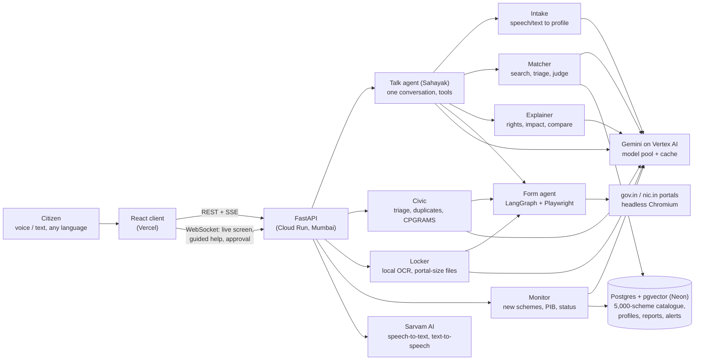
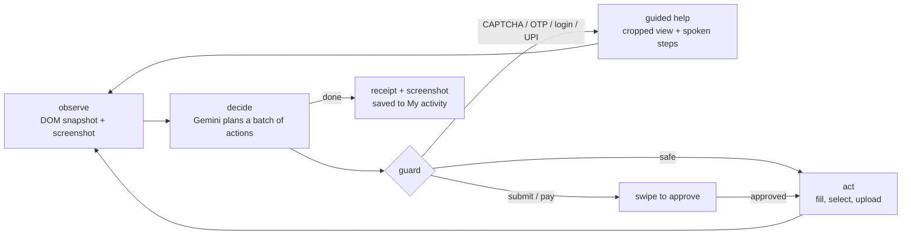

# Adhikaar (अधिकार)

**Know your rights, claim them.**

Forge Gen AI Buildathon, Theme 1 (Civic Pulse). Adhikaar combines **1.A Multilingual Policy, Rights & Scheme Explainer**, **1.B Civic Grievance Reporting** and **1.C Autonomous Public Service Agent** into one assistant.

- Live app: https://adhikaar-jade.vercel.app
- Live API docs: https://adhikaar-api-813554369403.asia-south1.run.app/docs

## The problem

India has more than 5,000 central and state welfare schemes, but the people they are written for rarely hear about them. The rules are in English legal language, spread over PDFs and portals, and applying means long forms, CAPTCHAs and OTPs. A farmer who has never used a website usually gives up or pays a middleman. Reporting a broken handpump or road is just as hard: which department, which portal, and did anyone act on it?

## What Adhikaar does

You talk to **Sahayak** in your own language, by voice or text. It hears which language you speak (Hindi, Bengali, Assamese, Tamil and others) and stays in it, with audio replies. From there it does three jobs:

| Job | What happens |
|---|---|
| **Understand** | Finds the schemes you qualify for from the live myScheme catalogue and checks every rule against your profile, with the exact official line behind each reason. Explains any scheme, notice, PDF or gov.in page in plain language: your rights, duties, restrictions, deadlines, what it means for you, and what changed between an old and a new version. |
| **Act** | A browser agent opens the government portal and fills the form while you watch. Your documents come from your locker (scan them with the phone camera; they are resized for the portal). When a CAPTCHA, OTP, login or UPI payment comes up, it shows that part of the screen large and tells you, in your language and by voice, exactly what to do. Nothing is submitted until you swipe to approve. |
| **Speak up** | Photograph a civic problem. AI names it, judges how urgent it is and which department is responsible, and shows matching reports nearby so you can add +1 instead of a duplicate. The agent then files it on CPGRAMS (you only enter the OTP), and the complaint's official status is tracked on your timeline next to updates from neighbours. |

Your profile keeps growing as you use it, so you never type the same thing twice. Everything you started (applications, complaints, alerts) is in one **My activity** timeline, and a background monitor tells you when a newly added scheme fits you.

There are two ways in: **Talk mode** (one voice conversation that does everything, made for people who have never used a website) and **Manual mode** (normal pages for students, families and helpers).

## Try it

1. Open the live app, press **Talk to Sahayak** and say or type, for example:
   *"मैं उत्तर प्रदेश का किसान हूँ, 2 एकड़ ज़मीन है, बेटी B.Sc में पढ़ती है"*
2. Sahayak replies in Hindi with audio and shows schemes as cards. Ask it to explain one, or say *"हाँ, आवेदन कर दो"* to start the form agent.
3. In **Schemes**, open a scheme to see each rule, whether you meet it, and the quoted official text.
4. In **Locker**, scan a document with the camera.
5. In **Civic**, report an issue with a photo and your location; try reporting the same thing twice to see duplicate detection.
6. **Explain**: paste a gov.in link or upload a PDF, or two versions to compare.

The first eligibility check for a brand-new profile takes about half a minute because Gemini reads each candidate scheme live. Results appear one by one as they are checked, and repeat checks come from cache.

## Architecture



### How the form agent works



It is a LangGraph state machine. Each step reads the page (fields, labels, options, current values) and asks Gemini for a short batch of actions. A deterministic guard checks every action before it touches the page: personal values are filled locally, never by the model; submit and pay always go to the approval gate; CAPTCHA and OTP always go to the citizen. The citizen sees a live screencast and can take over with their own clicks at any time.

### How eligibility matching works

1. **Catalogue:** all ~5,000 myScheme schemes are kept in Postgres with embeddings (`server/scripts/sync_catalog.py`), so a match never waits on dozens of live page fetches.
2. **Candidates:** category, state and central keyword searches plus a semantic search, ranked by how specific they are to the profile.
3. **Triage:** a fast model drops schemes aimed at a clearly different group (another state, PG-only, institution grants). A drop only counts if it quotes the official line, and income or age limits are re-checked in code.
4. **Judge:** for the rest, Gemini lists every eligibility and exclusion rule as met, not met or unknown, each with a quote.
5. **Verify:** every quote is checked against the official text. Reasons whose quote is not found are thrown away and the verdict is recomputed from what is left. Results stream to the screen as each scheme is judged.

### How civic reports work

Gemini vision reads the photo (and the transcribed voice note) and returns the problem, a severity with a one-line reason, and the responsible department from a fixed list of real departments. OpenStreetMap gives the address. Reports in the same category within 300 m are offered as duplicates. Filing on CPGRAMS runs the same form agent with a drafted complaint; the registration number is saved, and status checks add official updates to the timeline, labelled separately from citizen updates.

## Trust and safety

- **The AI never sees personal data.** Name, phone, Aadhaar, bank and address are encrypted and filled into forms locally. Documents are read by local OCR first, and only a redacted preview goes to the model.
- **Citizens handle CAPTCHA, OTP, login and payment.** The agent never solves them and never stores passwords; it only explains what to do.
- **Nothing is submitted or paid without a swipe to approve**, and a completed application cannot be submitted twice by accident.
- **Only government sites.** The agent can only open `gov.in` and `nic.in`.
- **Every claim has a source.** Eligibility reasons and explanation points quote official text, verified before they are shown.
- **No mock data.** Everything comes from live sources: myScheme, PIB, government pages and documents, CPGRAMS and the reports citizens file.

## Tech stack

| Layer | Used |
|---|---|
| Frontend | React 19, Vite, TypeScript, Tailwind 4, Leaflet + OpenStreetMap; English, Hindi, Bengali, Assamese UI |
| Backend | FastAPI (Python 3.12), async SQLAlchemy, background monitor loop |
| AI | Gemini (3.8/3.7 Flash, Flash Lite, embeddings) on Vertex AI via `google-genai`; LangGraph for the form agent |
| Browser automation | Playwright + Chromium, CDP screencast |
| Speech | Sarvam AI (`saaras:v4` speech-to-text with language detection, `bulbul:v3` text-to-speech) |
| Documents | Pillow, Tesseract OCR, pypdf |
| Data | Postgres + pgvector (scheme catalogue, embeddings, LLM answer cache, profiles, reports, alerts) |
| Hosting | Google Cloud Run (asia-south1), Neon Postgres, Vercel |

## Repository layout

```
client/                 React app: Home, Talk, Schemes, Scheme, Explain, Run, Runs, Locker, Civic, Activity, Alerts
server/app/agents/      talk.py (Sahayak), intake.py, matcher.py, explainer.py, chat.py, civic.py, executor.py (form agent), browser.py
server/app/services/    llm*.py (Gemini pool + cache), myscheme.py, feeds.py (PIB), sarvam.py, locker.py (OCR, variants),
                        geo.py, monitor.py (alerts), notify.py, rag.py, crypto.py
server/app/routers/     HTTP, SSE and WebSocket endpoints
server/scripts/         sync_catalog.py, try_agent.py, try_civic.py, eval_match.py, deploy_cloudrun.sh
server/tests/           pytest suite (offline + live)
```

## Running locally

You need Python 3.12, Node 20+, Docker (for Postgres with pgvector) and Tesseract OCR (optional on Windows, where the built-in OCR is used).

```bash
docker compose up -d db
```

**Backend**

```bash
cd server
python -m venv .venv
.venv\Scripts\activate          # Windows; on Linux/macOS: source .venv/bin/activate
pip install -r requirements.txt
playwright install chromium
cp .env.example .env            # then fill in the values below
uvicorn app.main:app --reload --port 8000
python scripts/sync_catalog.py  # once: copies the myScheme catalogue into your database
```

**Frontend**

```bash
cd client
npm ci
npm run dev                     # http://localhost:5173, talks to http://localhost:8000
```

### Configuration (`server/.env`)

| Variable | What it is |
|---|---|
| `DATABASE_URL` | Postgres URL. The default matches `docker-compose.yml`. |
| `GEMINI_BACKEND` | `vertex` (Google Cloud project) or `aistudio` (Gemini API key). |
| `GCP_PROJECT` | Google Cloud project for Vertex AI. Locally, log in once with `gcloud auth application-default login`. |
| `GEMINI_API_KEY` | Only when `GEMINI_BACKEND=aistudio`. |
| `SARVAM_API_KEY` | Sarvam AI key, for voice input and audio output. |
| `PROFILE_SECRET` | Fernet key that encrypts personal data. Generate one with `python -c "from cryptography.fernet import Fernet; print(Fernet.generate_key().decode())"`. |
| `CLIENT_ORIGIN` | Frontend origin(s) allowed by CORS, comma-separated. |
| `MONITOR_HOURS` | How often the alerts monitor checks for new schemes and PIB updates (default 6, `0` turns it off). |
| `AGENT_HEADLESS` | `false` shows the agent's browser window locally. |
| `AGENT_ALLOWED_DOMAINS` | Domains the agent may open (default `gov.in,nic.in`). |

All options are listed in `server/.env.example`.

### Try the form agent from a terminal

```bash
cd server
python scripts/try_agent.py https://www.myscheme.gov.in/find-scheme "find schemes I can apply for" "I am a 19 year old SC girl from Bihar studying B.Sc"
```

With `AGENT_HEADLESS=false` you can watch it and type any CAPTCHA or OTP when it asks.

## Tests

```bash
cd server && python -m pytest -m "not live" -q     # offline suite
cd server && python -m pytest -m live -q           # hits the real services
cd client && npm test
```

`server/scripts/eval_match.py --fresh` runs seven real profiles (student, farmer, widow, disabled job seeker, Class XI student, pregnant woman, street vendor) through live matching and fails if known-correct schemes are missed or wrong ones are recommended.

## Gemini usage

All model calls go through one pool (`server/app/services/llm_pool.py`): the best available model first with fallbacks, per-model rate limits, a timeout on every call, and a Postgres cache for judgements, explanations, triage and embeddings. `GET /api/health/llm` shows usage and cache hits. Run the API with one worker so all requests share the pool and the live agent sessions.

## Deployment

The live version runs on Google Cloud Run (`asia-south1`, so government portals see an Indian IP), Neon Postgres and Vercel. Setup and the one-command redeploy are in [DEPLOYMENT.md](DEPLOYMENT.md).

## Known limitations

- CAPTCHA, OTP, login and payment always need the citizen. That is by design.
- CPGRAMS status pages also need a CAPTCHA, so each status check asks the citizen for one; CPGRAMS also sends its own SMS updates.
- A first eligibility check for a new profile takes about half a minute; repeat checks are instant.
- Speech output covers the languages Sarvam supports; other languages get text replies.
- In the demo we stop at the approval step on live portals and do not make real submissions.

## Team

- Yash Choudhary
- (teammates)
