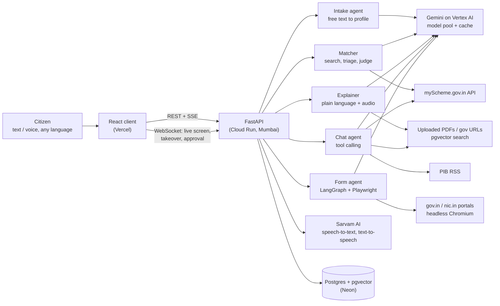
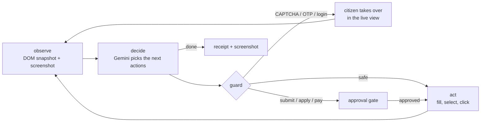

# Adhikaar (अधिकार)

**Know your rights, claim them.**

Forge Gen AI Buildathon, Theme 1 (Civic Pulse): **1.A Multilingual Policy, Rights & Scheme Explainer** combined with **1.C Autonomous Public Service & Bureaucracy Execution Agent**.

- Live app: https://adhikaar-jade.vercel.app
- Live API docs: https://adhikaar-api-813554369403.asia-south1.run.app/docs

## The problem

India has 5,000+ central and state welfare schemes, but the people they are meant for rarely know which ones apply to them. The rules are written in English legalese, eligibility is spread across PDFs and portals, and applying means fighting long government forms. Most people either give up or pay an agent.

## What Adhikaar does

You tell it about yourself in your own words, typed or spoken, in Hindi, English or another Indian language. Then it works in three steps:

| Step | What happens |
|---|---|
| **Understand** | Explains any scheme, notification, circular or PDF in plain language in your language, with audio. Every point is backed by a quote from the official text. |
| **Decide** | Searches the live myScheme catalogue, checks every eligibility rule of each scheme against your profile, and shows *eligible / likely / not eligible*, with the exact official line behind each reason and what's still missing. |
| **Act** | A browser agent opens the government portal and fills the form while you watch the live screen. It stops for you on CAPTCHA, OTP or login, and asks for your approval before anything is submitted. |

There's also a chat assistant ("Ask") that can search schemes, check eligibility, read uploaded documents and pull the latest PIB press releases, always with citations.

## Try it

1. Open the live app and press **Start**. Describe yourself, for example:
   *"मैं बिहार की 19 साल की SC छात्रा हूँ, B.Sc पहले साल में, परिवार की सालाना आय 1.4 लाख है"*
   (or use the mic). It asks a follow-up question if something important is missing.
2. **Schemes:** see which schemes you qualify for. Open one to see each rule, whether you meet it, and the quoted official text.
3. **Explain:** get the scheme, a government URL or an uploaded PDF explained in Hindi, with audio.
4. **Ask:** e.g. *"PM-KISAN की अगली किस्त कब आएगी?"* or *"latest PIB updates on scholarships"*.
5. **Run:** start the form agent on a portal (for example the myScheme scheme finder or the NSP scholarship eligibility checker) and watch it work. You approve the final step.

The first eligibility check for a new profile takes about a minute because it reads and checks ~30 schemes live. The same profile is answered from cache after that.

## Architecture



### How the form agent works



It is a LangGraph state machine. Each step reads the page (visible fields, labels, dropdown options, checkbox states) and asks Gemini for a batch of actions. A guard checks those actions before any of them touch the page. The citizen sees a live screencast over WebSocket and can take over with their own clicks and keystrokes at any time.

### How eligibility matching works

1. **Profile:** the intake agent turns free text or speech into structured fields (state, age, caste category, course, income, occupation…). Sensitive fields (name, phone, DOB, address, bank) are stored encrypted and kept separately.
2. **Candidates:** several live myScheme searches (category-specific, state-specific, central) plus a semantic search over cached schemes.
3. **Triage:** a fast check drops schemes aimed at a clearly different group (e.g. PG-only, ST-only, farmer-only). A drop is only accepted if the model quotes the official line that proves it.
4. **Judge:** for the rest, Gemini lists every eligibility and exclusion rule, decides met / not met / unknown, and must quote the official text for each.
5. **Verify:** we check every quote against the source text ourselves. Reasons whose quote isn't found are thrown away, and the final verdict is recomputed only from verified reasons. The model can't overrule its own evidence.

## Trust and safety

- **The LLM never sees personal data.** For personal fields the agent writes `value_from: "phone"`, and the real value is filled in locally. OTPs go straight from the citizen to the page.
- **Humans handle CAPTCHA, OTP and login.** The agent never tries to solve them.
- **Nothing is submitted without approval.** Any submit, apply or pay action stops at an approval gate.
- **Only government sites.** Navigation is restricted to `gov.in` and `nic.in`.
- **No unsupported claims.** Eligibility reasons and explanation points carry verbatim official quotes, which are verified before they're shown.
- **No mock data.** Everything comes from live sources: the myScheme.gov.in API, PIB RSS, the government pages and documents the user gives, and the live portals.

## Tech stack

| Layer | Used |
|---|---|
| Frontend | React, Vite, TypeScript, Tailwind; English + Hindi UI |
| Backend | FastAPI (Python 3.12), async SQLAlchemy |
| AI | Gemini (3.8 Flash first, with fallbacks) through Vertex AI, using the `google-genai` SDK; LangGraph for the form agent |
| Browser automation | Playwright + Chromium, CDP screencast |
| Speech | Sarvam AI (`saaras:v4` speech-to-text, `bulbul:v3` text-to-speech) |
| Data | Postgres + pgvector (embeddings for scheme and document search, LLM answer cache) |
| Hosting | Google Cloud Run (asia-south1), Neon Postgres, Vercel |

## Repository layout

```
client/                 React app (pages: Intake, Schemes, Scheme, Explain, Ask, Run, Runs)
server/app/agents/      intake.py, matcher.py, explainer.py, chat.py, executor.py (form agent), browser.py
server/app/services/    llm.py + llm_pool.py + llm_cache.py (Gemini), myscheme.py, feeds.py (PIB),
                        ingest.py + rag.py (documents), sarvam.py (voice), crypto.py
server/app/routers/     HTTP, SSE and WebSocket endpoints
server/scripts/         try_agent.py (run the form agent from a terminal), eval_match.py, deploy scripts
server/tests/           pytest suite (offline + live)
```

## Running locally

You need Python 3.12, Node 20+, and Docker (for Postgres with pgvector).

```bash
docker compose up -d db
```

**Backend**

```bash
cd server
python -m venv .venv
.venv\Scripts\activate          # Windows; on Linux/macOS: source .venv/bin/activate
pip install -r requirements.txt
playwright install chromium
cp .env.example .env            # then fill in the values below
uvicorn app.main:app --reload --port 8000
```

**Frontend**

```bash
cd client
npm ci
npm run dev                     # http://localhost:5173, talks to http://localhost:8000
```

### Configuration (`server/.env`)

| Variable | What it is |
|---|---|
| `DATABASE_URL` | Postgres URL. The default matches `docker-compose.yml`. |
| `GEMINI_BACKEND` | `vertex` (Google Cloud project) or `aistudio` (Gemini API key). |
| `GCP_PROJECT` | Google Cloud project for Vertex AI. Locally, log in once with `gcloud auth application-default login`. |
| `GEMINI_API_KEY` | Only when `GEMINI_BACKEND=aistudio`. |
| `SARVAM_API_KEY` | Sarvam AI key, for voice input and audio output. |
| `PROFILE_SECRET` | Fernet key that encrypts sensitive profile fields. Generate one with `python -c "from cryptography.fernet import Fernet; print(Fernet.generate_key().decode())"`. |
| `CLIENT_ORIGIN` | Frontend origin(s) allowed by CORS, comma-separated. |
| `AGENT_HEADLESS` | `false` shows the agent's browser window locally. |
| `AGENT_ALLOWED_DOMAINS` | Domains the agent may open (default `gov.in,nic.in`). |

All options are listed in `server/.env.example`.

### Try the form agent from a terminal

```bash
cd server
python scripts/try_agent.py https://www.myscheme.gov.in/find-scheme "find schemes I can apply for" "I am a 19 year old SC girl from Bihar studying B.Sc"
```

With `AGENT_HEADLESS=false` you can watch it and solve any CAPTCHA in the window.

## Tests

```bash
cd server && python -m pytest -m "not live" -q     # offline suite
cd server && python -m pytest -m live -q           # hits the real services
cd client && npm test
```

`server/scripts/eval_match.py` runs a live end-to-end eligibility check for a fixed profile and fails if known-correct schemes are missed or known-wrong ones are recommended.

## Gemini usage and limits

All model calls go through one process-wide pool (`server/app/services/llm_pool.py`):

- On Vertex AI it uses the best model first and falls back to the next if one is slow or failing.
- Every call has a 25 s timeout. Busy calls queue instead of failing.
- Eligibility judgements, explanations, follow-up questions and embeddings are cached in Postgres for 24 hours.
- `GET /api/health/llm` shows per-model usage, cooldowns and cache hits.

Run the API with **one worker** so all requests share the pool and the live agent sessions.

## Deployment

The live version runs on Google Cloud Run (`asia-south1`, so government portals see an Indian IP), Neon Postgres and Vercel. Setup and the one-command redeploy are in [DEPLOYMENT.md](DEPLOYMENT.md).

## Known limitations

- CAPTCHA, OTP and login always need the citizen. That's by design.
- myScheme records are sometimes missing tags (state, gender, course), so search uses several relaxed queries. A rare relevant scheme can still be missed.
- A first eligibility check takes about a minute. Repeat checks for the same profile are instant.
- In the demo we stop at the approval step and don't make real submissions on live portals.

## Team

- Yash Choudhary
